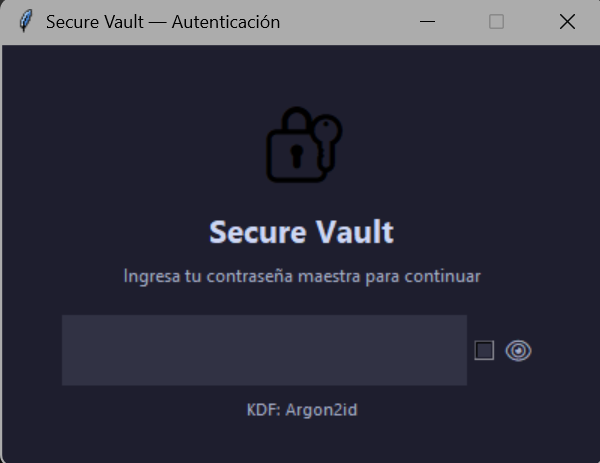
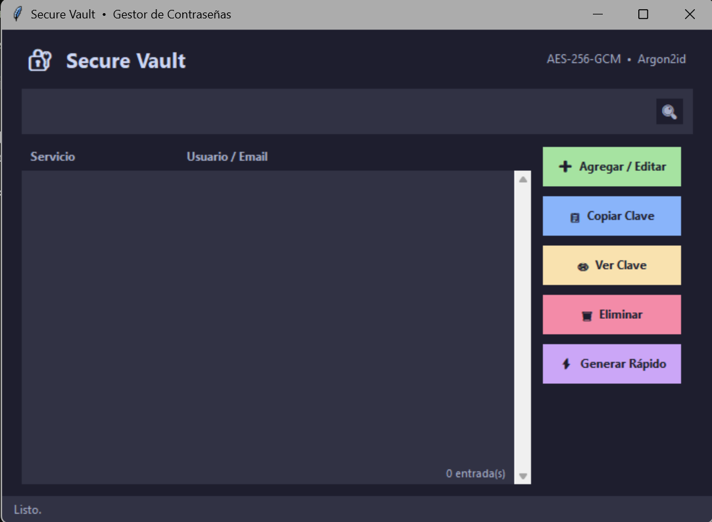
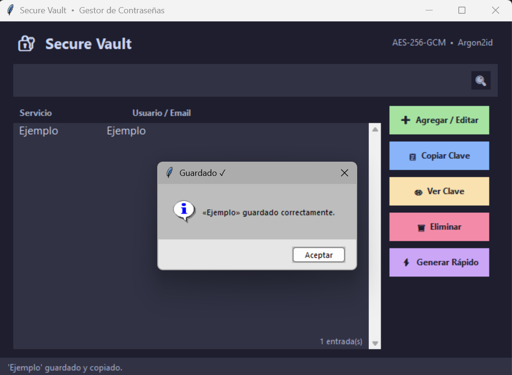
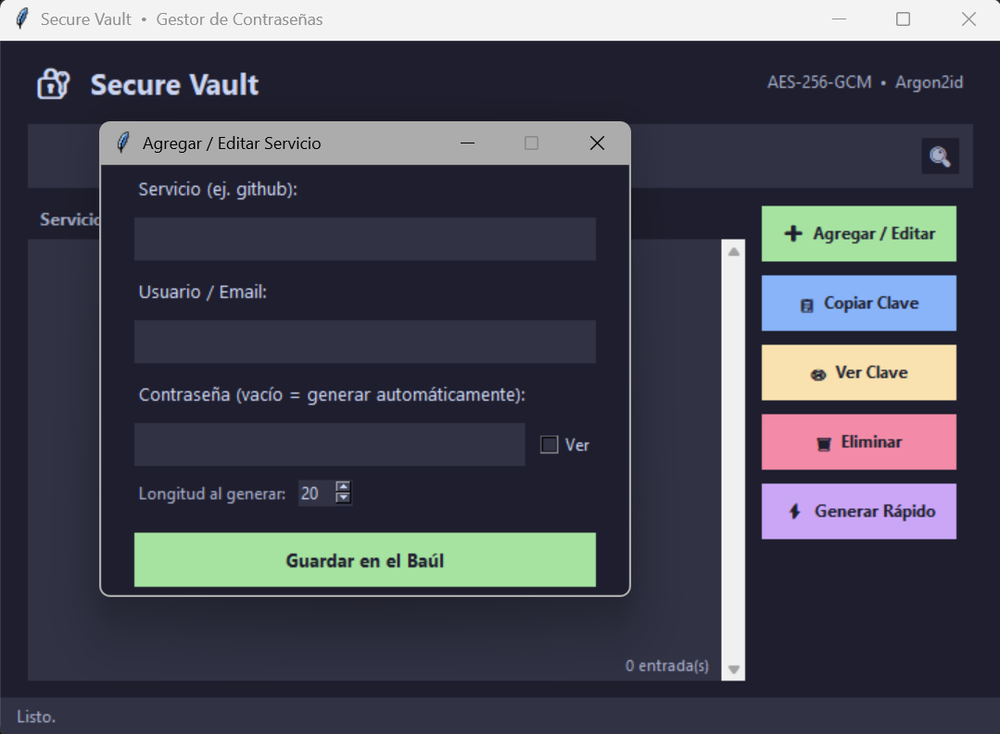
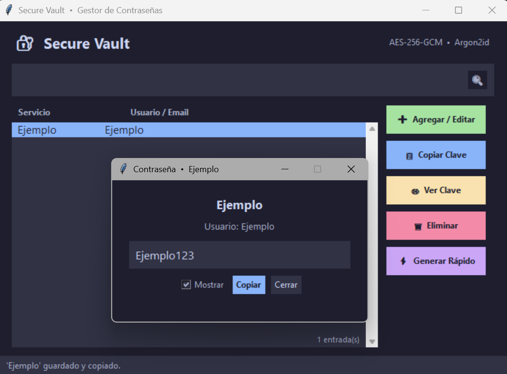
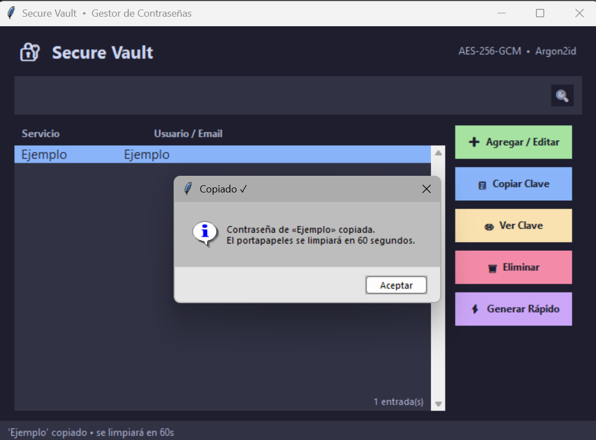
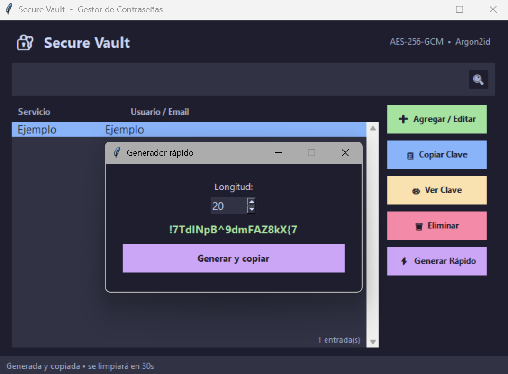

# Secure Vault — Gestor de Contraseñas Personal

Un gestor de contraseñas de escritorio seguro, ligero y desarrollado desde cero en Python, implementando criptografía de grado industrial para garantizar la privacidad absoluta de tus credenciales.

---

## Capturas de pantalla
 
<table>
  <tr>
    <td align="center" width="33%">
      <br/>
      <sub><b>Autenticación</b></sub>
    </td>
    <td align="center" width="33%">
      <br/>
      <sub><b>Lista de servicios</b></sub>
    </td>
    <td align="center" width="33%">
      <br/>
      <sub><b>Cuenta guardada</b></sub>
    </td>
  </tr>
  <tr>
    <td align="center" width="33%">
      <br/>
      <sub><b>Agregar / Editar servicio</b></sub>
    </td>
    <td align="center" width="33%">
      <br/>
      <sub><b>Ver contraseña</b></sub>
    </td>
    <td></td>
  </tr>
  <tr>
    <td align="center" width="33%">
      <br/>
      <sub><b>Limpieza automática del portapapeles</b></sub>
    </td>
    <td align="center" width="33%">
      <br/>
      <sub><b>Generador rápido de contraseñas</b></sub>
    </td>
    <td></td>
  </tr>
</table>

---

## Características

- **Cifrado AES-256-GCM** — Cifrado simétrico autenticado: los datos no solo están ocultos, sino protegidos contra manipulación externa.
- **Argon2id como KDF** — Estándar ganador del Password Hashing Competition (PHC 2015). Memory-hard: resistente a ataques por GPU y hardware especializado. Fallback automático a PBKDF2-SHA256 (600 000 iteraciones) si `argon2-cffi` no está instalado.
- **Limpieza automática del portapapeles** — La contraseña copiada se borra del portapapeles a los 30 segundos automáticamente.
- **Usuario / Email por servicio** — Cada entrada guarda el usuario o email junto a la contraseña cifrada.
- **Generador criptográfico de contraseñas** — Usa el módulo `secrets` de Python. Longitud configurable (12–64 caracteres) con garantía de incluir mayúsculas, minúsculas, dígitos y símbolos.
- **Búsqueda en tiempo real** — Filtra por nombre de servicio o usuario/email al instante.
- **Interfaz oscura** — GUI construida con `tkinter`, tema Catppuccin Mocha.

---

## Tecnologías

| Librería | Rol |
|---|---|
| `cryptography` | AES-256-GCM y PBKDF2-SHA256 |
| `argon2-cffi` | Argon2id KDF (recomendado) |
| `tkinter` | Interfaz gráfica (incluida en Python) |
| `pyperclip` | Integración con el portapapeles del sistema |
| `secrets` | Generación criptográfica de contraseñas |

---

## Instalación

1. Clona este repositorio:
   ```bash
   git clone https://github.com/Aniitchka/Password-Manager.git
   cd secure-vault
   ```

2. Instala las dependencias:
   ```bash
   pip install cryptography pyperclip argon2-cffi
   ```

   > `argon2-cffi` es opcional pero muy recomendado. Sin él, la app usa PBKDF2-SHA256 automáticamente.

3. Ejecuta la aplicación:
   ```bash
   python secure_vault.py
   ```

---

## Archivos generados (excluidos del repositorio)

| Archivo | Descripción |
|---|---|
| `vault.json` | Baúl cifrado con todas tus contraseñas |
| `salt.bin` | Salt único de 256 bits para la derivación de clave |

**Nunca subas `vault.json` ni `salt.bin` a ningún repositorio.** El `.gitignore` ya los excluye.

---

## Seguridad — Notas importantes

- La **contraseña maestra nunca se almacena** en disco, ni en texto plano ni cifrada. Solo se usa en memoria para derivar la clave AES.
- Si cambias de PBKDF2 a Argon2id (o viceversa), la clave derivada cambia y **el baúl anterior quedará inaccesible**. Haz un respaldo manual antes de cambiar el KDF.
- El `salt.bin` es único por instalación. Si lo pierdes junto con el `vault.json`, **no hay recuperación posible**.

---

## Roadmap

- [ ] Exportar e importar respaldos cifrados del baúl
- [ ] Timeout de sesión por inactividad
- [ ] Modo oscuro / claro intercambiable desde la UI
- [ ] Empaquetado como `.exe` con PyInstaller para distribución sin Python